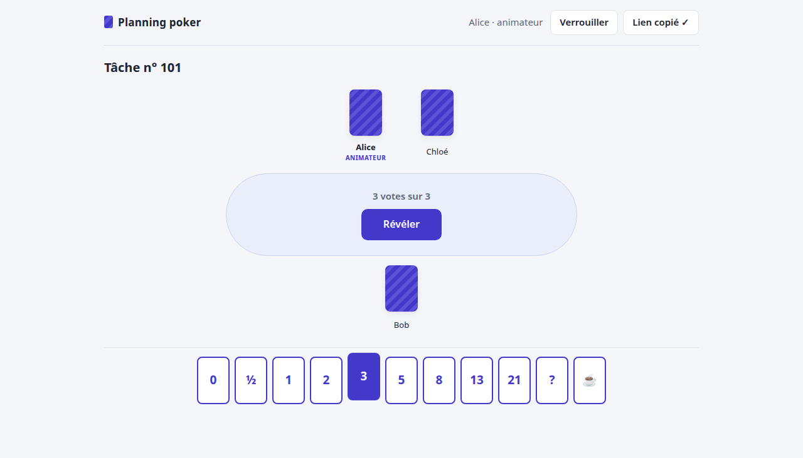
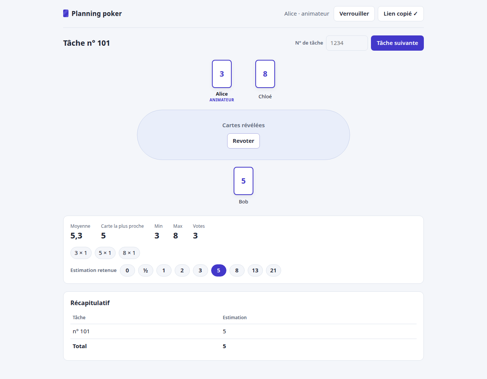

# Planning poker

A planning poker for a team, built on the YCappuccino framework (a showcase: one small app, nothing hand-rolled).
French UI. No account: pick a nickname, create a room, share its link.

 

- **Rooms** are links: `…/#<id>`, a random 192-bit id (never in server logs: it is the URL's fragment). No listing, no
  search; an unknown or expired room always answers "Salle introuvable.". Inactive rooms are purged after 90 days.
- **Identity**: the browser draws a 256-bit secret once and keeps it (localStorage). The server binds a nickname in a
  room to that secret (sha256), so nobody else can vote under it. Clearing the browser's data means a new identity.
- **Host**: the room's creator reveals, revotes, sets the final estimate, starts the next task (numbers only), removes a
  participant, locks the room. A host unseen for 2 minutes (`host_absent_seconds`; the page pings every 15 s) hands the
  room to the participant who joined next and is still present; the old host then returns as a normal participant.
- **Votes** stay hidden until revealed; then each card, the average, the nearest card, min and max; a recap of the
  finished tasks.
- **Live**: every call goes over a WebSocket (WS-RPC); each room's state is published on its pubsub topic.
- **Abuse**: per-address rate limits (room creation, unknown rooms asked, actions), 30 participants and 300 tasks a
  room, validated inputs, `noindex` everywhere.

## How it is built

- `ycappuccino.planningpoker.models`: `@Item` rooms, participants, tasks, votes (the only state: the store).
- `rooms.PlanningPoker`: the `IPlanningPoker` port (`api.py`, `@rpc_method(secure=False)`: it checks its callers
  itself). `room_events.RoomEvents` (an `ITrigger`) publishes a room's state on each change; `topic_access` lets
  anonymous browsers follow a room's topic; `rate_limits` counts per visitor address.
- `page/`: the Pyodide page (`PokerPage` over ui_web's `IWebPage`), `view.py` its logic without DOM, `deck.py` the rules
  both sides share.
- `ycappuccino_app.yml`: the composition (remote's RPC doors and WebSocket, pubsub, hosts; no REST/CRUD API).

The framework's repositories are private: building needs them checked out beside this repo (`[tool.uv.sources]`), or
their release wheels (`deploy/`).

## Run, test

```
./run.sh                                  # http://localhost:8080/ (memory storage); HTTP_PORT=... to change
source scripts/env.sh && python -m unittest discover -s src/unittest/python
uv run --no-project --with playwright python scripts/e2e/e2e_poker.py /tmp/shots   # 4 browsers, starts its own server
```

Until the framework's `poker` branches are released, `scripts/env.sh` and `conf/worktrees` take them from the
`<repo>-poker` worktrees beside this repo. `PYTHON=...` picks the interpreter run.sh and the e2e use.

## Deploy

`deploy/`: one image (`Dockerfile`, the framework's wheels fetched from its releases with a read-only `GH_TOKEN`
secret, `releases.lock`), its own MongoDB (`docker-compose.yml`), served under `/planningpoker` by the reverse proxy
(`httpd/planningpoker.conf`: removes the prefix, sets `X-Forwarded-For`, `X-Robots-Tag`). The container listens on the
host's loopback only.

```
GH_TOKEN=... docker compose -f deploy/docker-compose.yml up -d --build
```
